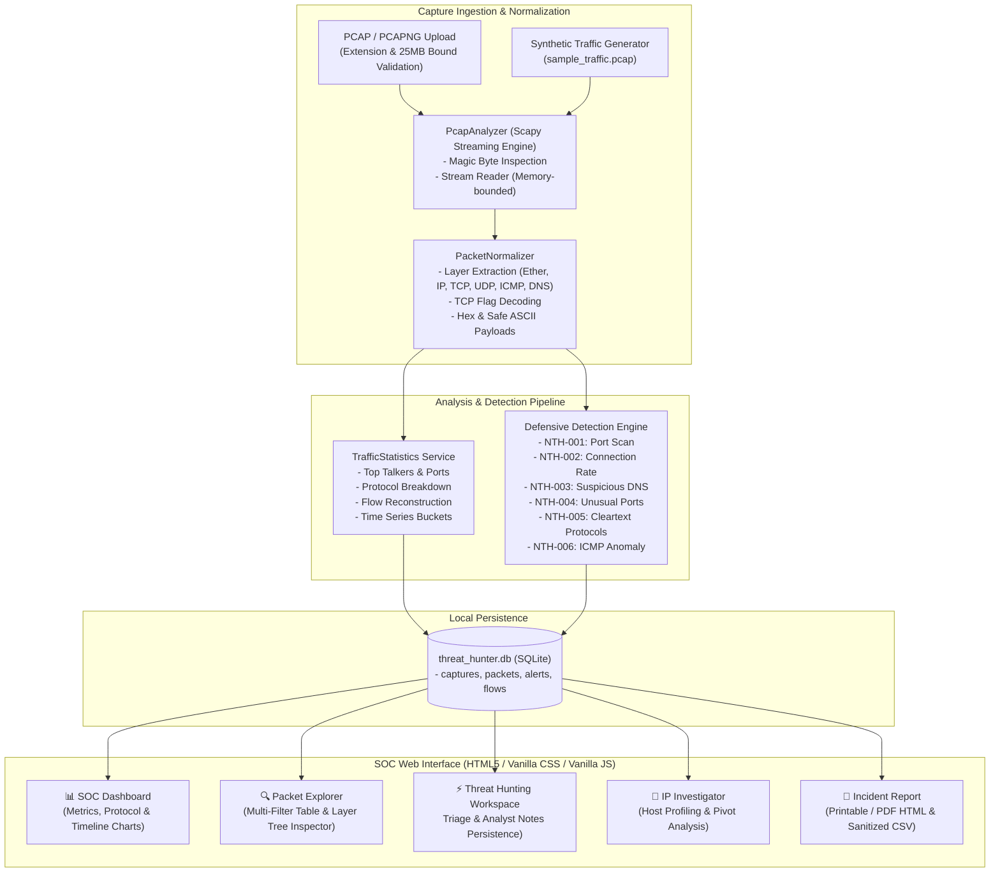

# NetworkThreatHunter — Network Traffic Analysis & Threat Hunting Platform

[](https://www.python.org/)
[](tests/)
[](app/)
[](LICENSE)
[](#10-security-and-defensive-design)

**NetworkThreatHunter** is a defensive cybersecurity and threat-hunting platform designed to analyze offline network packet captures (`.pcap` and `.pcapng`). Built with **Python**, **Scapy**, **Flask**, and **SQLite**, it extracts packet telemetry, reconstructs connection flows, computes protocol distributions, and executes deterministic threat detection heuristics without requiring external network connectivity or cloud APIs.

---

## 1. System Architecture



---

## 2. Key Capabilities

- **Offline Capture Ingestion:** Streams `.pcap` and `.pcapng` network captures locally using Scapy readers with file signature (magic byte) detection and memory bounding.
- **Dark SOC Dashboard:** Real-time metrics including total frames, wire bytes, duration, protocol shares, top source/destination talkers, active ports, and time-series traffic timeline.
- **Deep Packet Explorer:** Search and filter by source IP, destination IP, protocol, port, or free text. Click any packet to inspect decoded layer hierarchies, TCP flag decodings, formatted hex dumps, and printable ASCII snippets.
- **Connection Flow Reconstruction:** Reconstructs 4-tuple and 5-tuple bidirectional TCP sessions and estimates connection lifecycle states (`ESTABLISHED`, `RESET`, `CLOSED`, `INCOMPLETE`, `TRANSIENT`).
- **Explainable Threat Hunting Engine:** Deterministic cybersecurity detection heuristics providing Rule IDs, severity levels, trigger explanations, observed telemetry values, supporting packet frames, limitations, and actionable investigation recommendations.
- **Analyst Investigation Workspace:** Manage alert status lifecycle (`New` &rarr; `Investigating` &rarr; `Closed`) and record persistent investigation notes directly in SQLite.
- **IP Endpoint Investigator:** Pivot on any observed IP to review outbound and inbound communication partners, targeted destination ports, protocol usage, and linked threat alerts.
- **Defensive Sanitized Exports:** Export filtered packet summaries to CSV with built-in formula injection (DDE) mitigation, download JSON summaries and alerts, or print executive incident reports.

---

## 3. Threat Hunting Detection Catalog

| Rule ID | Rule Name | Severity | Primary Trigger Heuristic | Default Thresholds |
| :--- | :--- | :--- | :--- | :--- |
| **NTH-001** | Potential Port Scan | High / Med | Single source host probing distinct destination ports on a target | &ge; 12 distinct ports in &le; 60s |
| **NTH-002** | High Connection Attempt Rate | High | Rapid TCP SYN connection burst from one host indicating flood/probe | &ge; 12 conn/sec, min 20 attempts |
| **NTH-003** | Suspicious DNS Activity | Medium | Unusually long query names (DGA/tunneling) or high-frequency query bursts | &gt; 45 characters, or &ge; 8 queries/sec |
| **NTH-004** | Unusual Port Concentration | Medium | Traffic directed toward known backdoor/trojan indicator ports | Ports 4444, 1337, 31337, 6667, etc. (&ge; 5 pkts) |
| **NTH-005** | Cleartext Protocol Exposure | Low | Transmission over unencrypted protocols (HTTP, FTP, Telnet, POP3, IMAP) | Cleartext protocol headers or port 80/21/23 |
| **NTH-006** | ICMP Activity Anomaly | Medium / Low | Oversized ICMP payloads (covert channel) or high-frequency ICMP flood | Payload &ge; 96 bytes, or &ge; 15 pkts in &le; 5s |

### False-Positive Considerations
- **NTH-001:** Legitimate vulnerability scanners, enterprise asset inventory tools, or microservice service discovery may mimic port scanning.
- **NTH-002:** Automated load testing tools, web scrapers, or peer-to-peer sync clients can generate rapid connection bursts.
- **NTH-003:** Anti-virus telemetry, Content Delivery Networks (CDNs), and cryptographic lookups (DKIM, DNSSEC) legitimately query long domains.
- **NTH-004:** Custom internal staging software and proprietary database endpoints frequently run on non-standard ports.
- **NTH-005:** Protocol exposure highlights transport confidentiality risk; it does not establish unauthorized packet eavesdropping or credential theft.
- **NTH-006:** Network health monitors (Nagios, Zabbix) and MTU discovery scripts intentionally transmit repeated or sized ICMP packets.

---

## 4. Installation & Setup

### Prerequisites
- **Python 3.10+** (tested on Python 3.14 on Windows)
- **PowerShell** or any modern terminal

### Step 1: Clone / Enter Directory
```powershell
cd NetworkThreatHunter
```

### Step 2: (Optional) Create and Activate Virtual Environment
```powershell
python -m venv venv
.\venv\Scripts\Activate.ps1
```

### Step 3: Install Dependencies
```powershell
pip install -r requirements.txt
```

---

## 5. Execution Commands

### Run the Web Application
```powershell
python run.py
```
Open your browser and navigate to:
```
http://127.0.0.1:5000
```

### Generate Synthetic Demonstration Traffic PCAP
```powershell
python sample_data\generate_pcaps.py
```
*Note: A ready-to-use demonstration capture `sample_data/sample_traffic.pcap` is pre-generated in the repository for immediate testing.*

---

## 6. Automated Testing

Run the automated test suite with pytest:

```powershell
python -m pytest -v
```

### Actual Final Test Results
```text
tests\test_alerts_and_notes.py ...                                       [  8%]
tests\test_detection_engine.py .........                                 [ 33%]
tests\test_exports.py ...                                                [ 41%]
tests\test_packet_normalizer.py .......                                  [ 61%]
tests\test_pcap_analyzer.py ....                                         [ 72%]
tests\test_routes.py ........                                            [ 94%]
tests\test_traffic_statistics.py ..                                      [100%]

============================= 36 passed in 1.72s ==============================
```

All 36 unit and integration tests execute offline without requiring network access or external credentials.

---

## 7. How to Investigate Captures

1. **Upload Capture or Launch Demo:**
   - Click **Upload PCAP** to supply your `.pcap` or `.pcapng` file.
   - Alternatively, click **Demo Traffic** to load the synthetic multi-threat capture.
2. **Review Dashboard:**
   - Inspect total packet volume, top talkers, protocol shares, and active ports.
3. **Explore Packets:**
   - Navigate to **Packet Explorer**. Filter by protocol (e.g., `DNS`, `TCP`), filter by endpoint IP, or search for domain names.
   - Click any packet row to open the **Decoded Layer Inspector** and examine header fields, flags, and hex dump.
4. **Triage Threat Alerts:**
   - Navigate to **Threat Hunting**. Filter alerts by severity or triage status.
   - Click **Investigate &rarr;** on any alert to read the technical rationale, verify supporting packet frames, update the status (`New` &rarr; `Investigating` &rarr; `Closed`), and save analyst notes.
5. **Pivot with IP Investigator:**
   - Navigate to **IP Investigator** and select an IP to inspect inbound/outbound communication peers, destination ports targeted, and linked alerts.
6. **Generate Incident Report:**
   - Navigate to **Incident Report** to generate an executive report styled for printing or PDF export.

---

## 8. Security & Privacy Design

- **Localhost-First Execution:** NetworkThreatHunter binds exclusively to `127.0.0.1` by default and makes zero outbound network requests.
- **CSV Formula Injection Mitigation:** All CSV export cells are sanitized (`ReportGenerator.sanitize_csv_cell`) by prepending single quotes (`'`) to strings starting with `=`, `+`, `-`, `@`, `\t`, or `\r`.
- **Safe File Handling:** Uploaded files receive cryptographically random UUID filenames. User-supplied paths are never passed to the operating system filesystem.
- **Resource Exhaustion Bounds:** Enforces a configurable 25 MB file upload limit and an analysis ceiling (`MAX_PACKETS_PER_CAPTURE = 50,000`) to prevent memory exhaustion.
- **SQL Injection Defense:** All database queries utilize parameterized SQL statements via Python's `sqlite3` driver.
- **XSS & Output Escaping:** All UI views are protected by Jinja2 autoescaping.

---

## 9. Supported Protocols & File Formats

- **File Types:** Standard PCAP (`.pcap`, microsecond and nanosecond magic bytes) and PCAPNG (`.pcapng`, Section Header Block).
- **Network Protocols:** IPv4, IPv6, ARP.
- **Transport Protocols:** TCP (with flag decoding: SYN, ACK, FIN, RST, PSH, URG), UDP, ICMP, ICMPv6.
- **Application Identifiers:** DNS (Query name, query type, response codes), HTTP (Methods, status, headers), TLS/HTTPS (Encrypted marker), FTP, Telnet.

---

## 10. Suggested Screenshots for Portfolio

When presenting this project in a portfolio or case study, include:
1. **SOC Dashboard:** Showing the top metrics bar, responsive traffic volume timeline, protocol breakdown, and top talkers.
2. **Packet Explorer & Layer Inspector:** Showing the filter bar, packet table, and the deep inspection drawer displaying decoded protocol headers and hex dump.
3. **Threat Hunting Triage:** Showing the alerts list with severity badges, status pills, and rule summaries.
4. **Alert Investigation & Analyst Notes:** Showing an alert detail page with technical rationale, limitations, analyst notes editor, and supporting packet frames.
5. **IP Investigator:** Showing host profiling, outbound communication partners, and targeted ports.
6. **Printable Incident Report:** Showing the clean, printable executive summary and threat findings.

---

## 11. Ethical & Authorized-Use Scope

NetworkThreatHunter is engineered strictly for **defensive network analysis**, incident response training, forensic review, and authorized security research. It performs passive, offline inspection of captures provided by the user. It does not perform live network packet injection, automated exploitation, unauthorized scanning, or credential harvesting.

---

## 12. License

This project is licensed under the [MIT License](LICENSE).
